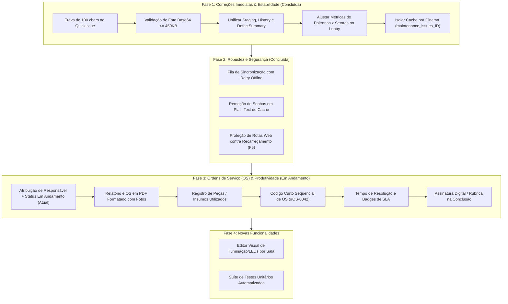

# Relatório de Auditoria Técnica e Plano de Melhorias • CineGestor

**Data da Auditoria:** 18 de Novembro de 2026  
**Status do Projeto:** Em desenvolvimento (`feature/chamado-rapido`)  
**Escopo:** Código Dart (`lib/`), Regras de Segurança (`firestore.rules`), Gerenciamento de Estado, Integração Firebase e Armazenamento Local.

---

## 1. Resumo Executivo

O CineGestor evoluiu com sucesso com arquitetura visual Apple-style, separação de papéis RBAC, suporte a múltiplas unidades da rede UCI e novos módulos de **Chamado Rápido** e **Gestão de Áreas Comuns (Bomboniere, Foyer, Banheiros, etc.)**.

No entanto, a recente expansão de escopo revelou inconsistências técnicas entre telas que ainda tratavam todas as demandas como *"poltronas de sala de cinema"*, além de regras de validação no Firestore que podem rejeitar chamados silenciosamente e oportunidades de segurança em autenticação e isolamento de cache.

---

## 2. Inconsistências Técnicas e Riscos Identificados

### A. Validação e Sincronização com o Firestore (Crítico)
| Item | Problema Identificado | Impacto |
| :--- | :--- | :--- |
| **Limite de 100 caracteres no `problemType`** | O `QuickIssueDialog` concatena categoria + descrição (`${categoria}: ${descricao}`). O `firestore.rules` exige `<= 100` caracteres. Descrições mais longas são rejeitadas pelo Firestore. | Perda silenciosa de chamados no banco na nuvem. |
| **Erros de sincronização silenciados** | Em `RoomController._syncIssueToFirestore`, erros são capturados com `debugPrint`. O app exibe mensagem de sucesso porque salvou no cache local, mas o registro não sobe ao banco. | Falsa confirmação de abertura de chamado para o operador. |
| **Fotos Base64 sem verificação de cota** | O Firestore limita strings Base64 a `450.000` caracteres. Fotos de alta resolução ou sem compressão suficiente ultrapassam o limite sem aviso prévio na UI. | Rejeição no Firestore por violação de regra de segurança. |

---

### B. Inconsistências de UI com Setores e Áreas Comuns
| Tela | Inconsistência | Comportamento Esperado |
| :--- | :--- | :--- |
| **Triagem (`StagingPage`)** | Exibe `'Sala setor_bomboniere • Poltrona GERAL-AR-COND'` em chamados rápidos fora de salas. | Identificar visualmente se é **Área Comum** ou **Sala**, usando o nome amigável do setor (`Bomboniere • Ar-Condicionado`). |
| **Histórico (`HistoryPage`)** | Exibe rótulos brutos no título e nos relatórios exportados; dropdown de filtro lista apenas salas, ocultando Áreas Comuns. | Exibir `targetDisplayLabel`, adicionar os setores comuns no dropdown de filtro e formatar relatório. |
| **Tarefas por Defeito (`DefectSummaryPage`)** | Oculta chamados de Áreas Comuns (filtra apenas salas); cada descrição vira um filtro separado no topo. | Incluir seção para Áreas Comuns e agrupar chamados rápidos pelo tipo base da categoria. |
| **Métricas do Lobby (`RoomSelectionPage`)** | `affectedSeatsCount` soma itens de Bomboniere e Banheiros e exibe como *"X poltronas"*; termômetro da sala inclui itens `GERAL-*` no cálculo percentual de assentos. | Separar métricas de poltronas de infraestrutura predial; termômetro deve considerar apenas poltronas físicas. |

---

### C. Isolamento de Dados e Cache
| Item | Problema | Solução |
| :--- | :--- | :--- |
| **Cache local compartilhado entre cinemas** | `SharedPreferences` utiliza a chave fixa `'maintenance_issues'` para todas as unidades. Ao trocar de cinema, dados da unidade anterior podem piscar em tela. | Salvar sob a chave `'maintenance_issues_${activeCinemaId}'`. |
| **Inicialização fora de ordem** | `RoomController..loadRooms()` é disparado no `main.dart` antes de `AuthController.initSession()` saber qual é o cinema do usuário logado. | Carregar salas respeitando o `cinemaId` da sessão ativa. |

---

### D. Segurança e Autenticação
| Item | Gravidade | Descrição | Status |
| :--- | :--- | :--- | :--- |
| **Senhas salvas em texto puro no cliente** | Média | O método `_saveLocalUsers` salva a senha em texto puro no `SharedPreferences` (`managed_users_cache`). | ✅ Resolvido (`feature/sync-e-robustez`) |
| **Credenciais fixas no código-fonte** | Baixa/Média | A senha mestre de bootstrap `admin123` e o prefixo `cine` estão no código compilado. | Pendente |
| **Fallback para login offline sem token** | Média | Ao autenticar exclusivamente pelo cache local se a rede falhar, o Firebase Auth não emite token, gerando erros de permissão em chamadas subsequentes ao Firestore. | ✅ Resolvido (sessão persistida via Auth, sem senhas locais) |

---

## 3. Plano de Ação e Melhorias (Roadmap de Execução)

---

## 4. Detalhamento das Melhorias em Ordens de Serviço (OS)

| Item | Objetivo | Status |
| :--- | :--- | :--- |
| **1. Atribuição de Responsável + Status 'Em Andamento'** | Permitir indicar quem está executando o reparo (técnico interno ou terceirizada) e marcar a OS como 'Em Andamento' para sinalizar que o serviço já foi iniciado. | ✅ Concluído (`feature/os-responsavel`) |
| **2. Relatório / OS em PDF Formatado com Fotos** | Exportação profissional em PDF com logotipo, dados do cinema, fotos de antes/depois lado a lado e espaço para assinatura. | ✅ Concluído (`feature/os-responsavel`) |
| **3. Registro de Peças e Peças Substituídas** | Registro de insumos gastos (molas, parafusos, lâmpadas, braços) para controle de estoque e custos. | ⏳ Próximo da Fila |
| **4. Código Curto Sequencial (#OS-0042)** | Código amigável e legível para comunicação ágil via rádio ou mensagens de texto entre a equipe. | 📋 Na Fila |
| **5. Tempo de Resolução (SLA / Métricas)** | Indicadores visuais de tempo decorrido desde a abertura até a conclusão (ex: 'Resolvido em 45min'). | 📋 Na Fila |
| **6. Assinatura Digital na Conclusão** | Rubrica desenhada na tela pelo responsável/gerente para comprovação formal de entrega do serviço. | 📋 Na Fila |

